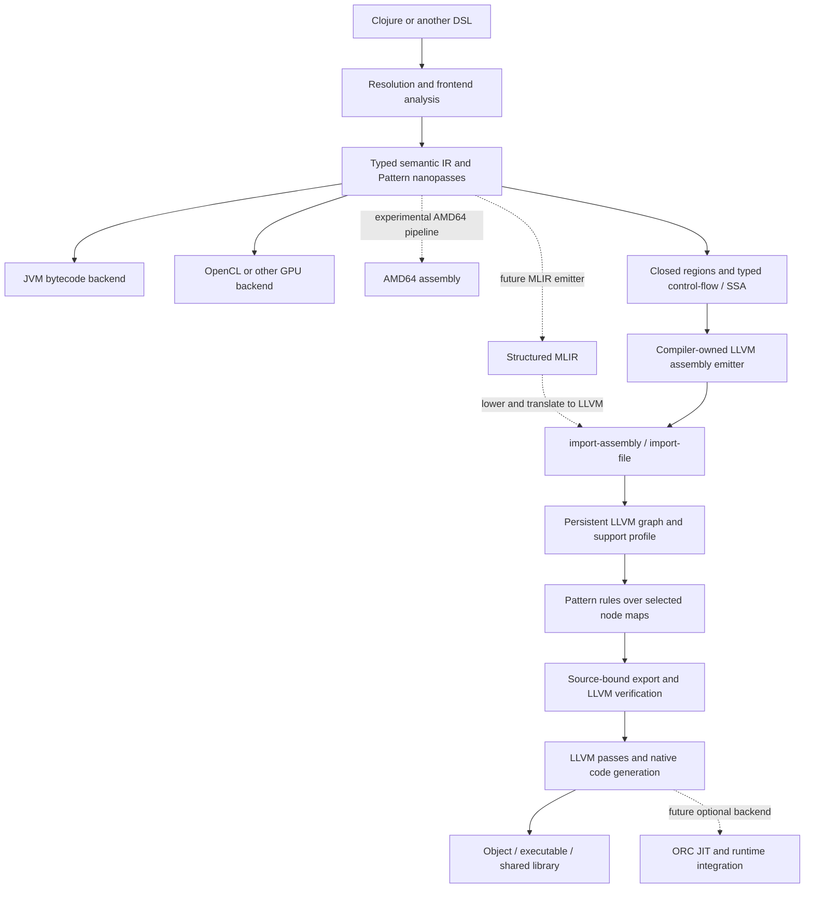

# Building native compilers with Pattern and LLVM

Pattern supplies the compiler language and transformation layer: data, dialects,
rewrite rules and nanopasses. LLVM can supply optimization, target lowering and
native code generation. The optional adapter connects these layers through
ordinary persistent data, without requiring LLVM in Pattern core.

This first iteration provides verified LLVM import, inspection, narrow persistent
edits, export, and a working native numeric example. It is a backend foundation
for compiler authors. A reusable LLVM construction dialect and a full native
Clojure runtime are later projects.

## The compiler boundary



The upper branches describe the architecture available to compiler authors, not
backends implemented by this adapter. Keep high-level facts such as Clojure Vars,
collection operations, overflow policies, shapes, effects and ownership in the
frontend IR until an appropriate lowering makes their representation explicit.
LLVM validity does not establish preservation of those source semantics.

[def-dialect / def-derived](../../src/pattern/nanopass/dialect.clj) describe source
and intermediate languages. [defpass](../../src/pattern/nanopass/pass.clj) and
Pattern rule combinators express small transitions between them. A compiler
should validate each transition's input/output and semantic invariants explicitly;
declaring a dialect arrow does not prove a pass correct. Examples of the existing
framework are in [nanopass_test.clj](../../test/nanopass_test.clj).

A useful eventual sequence is resolved Core → typed/effect-annotated regions →
explicit control flow → SSA → LLVM emission. It need not be the same sequence for
every frontend. A compiler that already has typed SSA can start near the end.

The current [numeric frontend](examples/i64.clj) combines resolution, SSA building
and assembly printing in a handwritten recursive emitter. It uses private mutable
construction state, then publishes assembly. It is **not a nanopass frontend**.
The [example runner](examples/run.clj) genuinely uses Pattern rules after LLVM
import. Separating the frontend into dialects and passes is a future refactoring,
with its existing differential tests as the acceptance baseline.

## A working emitter-to-Pattern recipe

From the Pattern root, build the bridge as described in the [module guide](README.md)
and start `clojure -J-Xmx384m -M:llvm`. This small example uses the existing numeric
frontend as its terminal emitter; a different compiler can supply its own assembly.

```clojure
(require '[pattern :as p]
         '[pattern.llvm :as llvm]
         '[pattern.llvm.graph :as graph]
         '[pattern.llvm.support :as support])
(load-file "modules/llvm/examples/i64.clj")

(def bridge "./modules/llvm/target/bridge")
(def assembly
  (pattern.llvm.examples.i64/compile-module
    '[(defn twice-plus-one [x]
        (unchecked-add (unchecked-multiply x 2) 1))]))

;; The emitter returns text; the adapter parses/verifies it and returns data.
(def baseline (llvm/import-assembly bridge assembly))
(def add-node
  (first (filter #(= "add" (:opcode %)) (vals (:nodes baseline)))))
(support/require-support! baseline
  {:nodes [(:id add-node)] :operation :set-operand
   :fields [:nuw :nsw] :metadata :none :debug-records :none})
(assert (and (false? (:nuw add-node)) (false? (:nsw add-node))))
(def swap-add
  (p/rule '(?:as node {:opcode "add" :operands [?a ?b]})
    (assoc node :operands [b a])))
(def child (graph/rewrite-node baseline (:id add-node) swap-add))
(llvm/export-file! bridge child "./twice.ll") ; destination must be new
```

`clang-21 -O3 -c twice.ll -o twice.o` produces an object with a C-ABI
`int64_t clj_twice_plus_one(int64_t)` function. Linking or loading that object is
a separate toolchain/FFI step. The [prime example](examples/README.md) supplies a
complete C driver and checks native results against the same Clojure definitions.

`import-assembly` uses an isolated temporary UTF-8 file and the same native parser,
verifier, limits and support profile as `import-file`. No source program is
executed. Both require an explicitly selected bridge executable.
Emit an explicit stable `source_filename` for repeatable module/graph identity;
otherwise LLVM derives it from the private temporary filename. Module identifiers
are presentation data, and capsule hashes bind the exact import's bytes rather
than promising a path-independent compiler cache key.

Assembly emission and snapshot export have different contracts. An emitter
**constructs** a new module. `export-file!` **replays admitted edits** against an
imported complete module; arbitrary `assoc` changes to snapshot maps are rejected.
There is no general data-to-LLVM constructor in the current API. A future builder
needs its own versioned construction profile for definitions, types, block
terminators, PHIs, dominance, target layout, calling conventions and metadata.

Imported LLVM is a graph with identity, use sites and cycles. Apply ordinary
Pattern rules to selected node maps and use the graph transaction API. A generic
tree traversal must not recursively follow every integer reference. Unsupported
operations or fields must fail explicitly rather than silently disappear.

## Raster integration options

The inspected Raster checkout has an existing CPU-C path in
[`compile-aot :target :c`](https://github.com/replikativ/raster/blob/1c47d3e3729f402944487c1c78e723fb61a1449b/src/raster/compiler/pipeline.clj#L1223),
with a whole-function C emitter and a Panama FFM loader. Its JVM, GPU and Wasm
paths also provide useful examples of shared front-half compilation. This is
repository evidence, not a claim that a Pattern LLVM target has been integrated.

The smallest Raster experiment would be:

1. Retain Raster's existing analysis, fusion, scheduling and C emission.
2. Compile the emitted C with a matching Clang using `-S -emit-llvm`.
3. Import the module through Pattern, inspect it and apply admitted rewrites.
4. Export/verify, compile a shared library, and reuse Raster's existing C ABI/FFM
   invocation and differential checks.

This makes LLVM transparent at an existing backend seam. It does not require
loading a Scheme runtime or reimplementing Raster's frontend. Preserve its chosen
floating-point/overflow policy, target and flags; a new LLVM route must not
silently change them. Cache keys need the compiler/toolchain versions, target,
data layout, pass options, ABI and specialization assumptions as well as source.

A later direct LLVM target can remove the intermediate C source. Raster's
[`compile-wasm`](https://github.com/replikativ/raster/blob/1c47d3e3729f402944487c1c78e723fb61a1449b/src/raster/compiler/pipeline.clj)
is a useful reference for reusing a typed front-half with explicit signatures.
Its [KernelBody vocabulary](https://github.com/replikativ/raster/blob/1c47d3e3729f402944487c1c78e723fb61a1449b/src/raster/compiler/ir/kernel_body.clj)
already names scalar SSA, control flow and memory operations. Retain those facts,
the operation descriptors and the kernel ABI instead of deriving them again from
untyped forms. GPU execution and target-specific kernel conventions need their
own validation; reading LLVM IR alone does not establish them.

No Raster files are changed by this iteration.

## Direct MLIR emission from Raster

Direct Raster → MLIR is a peer route to direct LLVM emission. It can preserve
structured loops, shapes and vector intent for additional lowering decisions.
The existing C backend is useful for a quick comparison; it need not be the
architecture of a future MLIR target.

| Raster input | Candidate MLIR dialects |
| --- | --- |
| Typed scalar computations and constants | `arith`, with `math` when needed |
| If/loop regions, carried values and yields | `scf`, later `cf` |
| Typed buffers, shapes, strides and scalar accesses | `memref` |
| Explicit SIMD intent | `vector` |
| Thread/workgroup/launch and synchronization facts | `gpu`, followed by a selected target path |
| Earlier unscheduled SOAC/contraction equations | Potentially `linalg` |
| Final low-level operations | LLVM dialect, then LLVM IR |

Choose the entry level deliberately: `linalg` fits before schedules have been
committed, while scheduled KernelBody operations should retain those decisions.
Legality also matters: [scf.for](https://mlir.llvm.org/docs/Dialects/SCFDialect/)
requires a positive step, [arith](https://mlir.llvm.org/docs/Dialects/ArithOps/)
overflow promises can introduce poison, and
[memref](https://mlir.llvm.org/docs/Dialects/MemRef/) accesses require valid bounds.
Loop legalization, masking, trapping and numerical policies remain compiler work.

The current bridge does **not** parse MLIR. A separate optional adapter would need
a registered dialect inventory, parser/verifier, pass pipeline and versioned data
profile for operation/results, regions, blocks, block arguments, operands,
successors, types, attributes/properties and locations. The
[MLIR C API](https://mlir.llvm.org/docs/CAPI/) exposes useful primitives but has no
stability guarantee; native handles and context lifetimes must stay scoped.

[LLVM import/export in MLIR](https://mlir.llvm.org/docs/TargetLLVMIR/) provides a
possible low-level interchange boundary. The documented LLVM import is limited
and experimental, and produces LLVM-dialect operations. It does not reconstruct
the original `scf`/`linalg`, shapes, schedules or ownership from LLVM IR. Preserve
persistent snapshots before lowering and test each admitted round trip explicitly.

A bounded first MLIR slice could lower a wrapping i64 buffer sum through
`func + arith + scf + memref` → LLVM dialect → LLVM IR → this adapter → shared
library. Use an externally owned contiguous buffer and an explicit C ABI wrapper;
compare empty inputs, carried values and overflow against Raster/JVM execution.
The memref descriptor ABI must not be assumed identical to a raw pointer/length
signature.

## Comparing Pattern's direct AMD64 experiments

[compiler_course/r1.clj](../../test/compiler_course/r1.clj) already contains a
genuine Pattern dialect/rule compiler to AMD64 assembly: sixteen passes followed
by printing. It covers closure conversion, allocation, explicit control flow,
instruction selection, register allocation, patching and saved registers.

This is useful backend prior art rather than a currently validated alternative.
Several [tutorial tests](../../test/compiler_course/r1_test.clj) are disabled, and
the core CI alias excludes tutorial dependencies. Its
[allocator](../../test/compiler_course/r1_allocator.clj) and
[assembly printer](../../test/compiler_course/pass17_stringify.clj) retain TODOs
around runtime/root-stack and calling conventions. No end-to-end assembler/link/
execution harness was established in this investigation. The separate Scheme-to-C
and CPS tutorials likewise should not be presented as shipped compiler backends.

| Strategy | Useful control | Compiler/runtime work retained |
| --- | --- | --- |
| Direct AMD64 | Exact instructions, internal ABI, tail-call sequence, stack/root maps and instrumentation | Selection, allocation/spills, ABI, unwind/debug, assembler/object integration and each supported target |
| LLVM IR | Typed low-level data, mature optimizer/targets, object/shared-library output | Source semantics, SSA, representations, runtime/FFI, effects and specialization policy |
| MLIR then LLVM | Structured/target-aware intermediate levels before native lowering | Dialect selection, legalizations, conversion pipelines and descriptor/target ABIs, plus the runtime contract |
| Chez/Jolt route | Compiler algorithms or an existing dynamic runtime host | Ported algorithms and runtime assumptions, or the Scheme runtime/representations when using Jolt |

These routes can share validated upper dialects. Direct AMD64 may be attractive
for a small baseline compiler with predictable code generation; LLVM may provide
better optimization and target coverage. Neither latency nor execution speed has
been compared here. The current AMD64 experiment prints assembly and does not
establish an in-process JIT.

A useful later comparison would use the same typed allocation-free kernel and ABI
across a repaired AMD64 path, minimally optimized LLVM, optimizing LLVM, and
optionally Raster→MLIR→LLVM. Measure warm-REPL frontend/pass time, emission,
parse/verification, optimization/codegen, assembly/link/load, first call, steady
execution, RSS and artifact size separately. Closure/GC/tail-call workloads need
their runtime contracts before being added. Assembler acceptance and LLVM
verification each check a backend boundary, not full source equivalence.

## What to borrow from ChezScheme and Jolt

Chez's [compiler pipeline](https://github.com/cisco/ChezScheme/blob/cd71c2af0a61f9d80a67db88779300ba7d810138/s/cpnanopass.ss)
separates normalization, closure conversion, direct-call/closure optimization,
primitive expansion and trap checks from target calling conventions, register
allocation and emission. Its [source optimizer](https://github.com/cisco/ChezScheme/blob/cd71c2af0a61f9d80a67db88779300ba7d810138/s/cp0.ss)
is useful algorithmic prior art for folding and bounded specialization. Borrow
these high-level techniques as small Clojure passes. LLVM can continue to own
instruction selection, register allocation and object emission.

Jolt's [host-neutral map IR](https://github.com/jolt-lang/jolt/blob/33a1bfc44010c0a3dd61ba6dce8e67303ffe0cff/jolt-core/jolt/ir.clj)
and [optimization passes](https://github.com/jolt-lang/jolt/blob/33a1bfc44010c0a3dd61ba6dce8e67303ffe0cff/jolt-core/jolt/passes.clj)
are particularly relevant to staged compilation. They make dynamic/redefinable
Vars, redefinition and representation assumptions part of inlining/direct-linking
policy. A native specialization should similarly record what was closed, the
guards it relies on, and when it becomes invalid.

Jolt's [Scheme host](https://github.com/jolt-lang/jolt/blob/33a1bfc44010c0a3dd61ba6dce8e67303ffe0cff/host/chez/compile-eval.ss)
also supplies runtime services. Its collections and dynamic-binding machinery
cannot disappear merely by choosing LLVM. Direct LLVM is a good fit for closed
numeric/buffer regions; a whole native Clojure additionally needs values, closures,
allocation/GC, persistent collections, exceptions, Vars, dynamic binding and FFI.
Jolt remains useful as an alternate runtime and comparison implementation.

Persistent compiler snapshots and forkable running programs are distinct. Keep
analysis and published pass results persistent, permit private mutable builders,
and treat native code ownership, profiling, invalidation, deoptimization and
continuation capture as separate runtime contracts.

## Related ecosystem options

Research snapshot: **2026-10-18**. These are possible complements and prior art,
not supported integrations or newly required dependencies.

| Option | Useful role | Boundary |
| --- | --- | --- |
| [tools.analyzer](https://github.com/clojure/tools.analyzer) / [tools.analyzer.jvm](https://github.com/clojure/tools.analyzer.jvm) | Optional Clojure AST/macro-expansion frontend before selected typed Pattern regions | Pin/test accepted AST forms. Macro expansion uses the host environment and can execute macro code; analysis does not supply a native runtime. |
| [jank](https://jank-lang.org/blog/2026-05-08-optimization/) | Native Clojure-dialect implementation and high-level SSA/CFG prior art | Its author documents why Clojure-semantic IR belongs above LLVM. Its data-form IR dump is not a round-trip compiler API; runtime integration is separate. |
| [JavaCPP LLVM presets](https://github.com/bytedeco/javacpp-presets/tree/master/llvm) | Candidate optional in-process LLVM C-API, passes and ORC implementation | Native handles/lifetimes remain explicit. Current main targets LLVM 22; select a matching artifact or add a separately tested profile instead of assuming LLVM 21 compatibility. |
| [Coffi](https://github.com/IGJoshua/coffi) | Clojure calls into generated C-ABI shared libraries | Uses JDK 22+ FFM. It need not become a dependency of the JDK 17+ subprocess adapter. |
| [dtype-next](https://github.com/cnuernber/dtype-next) | Typed buffers and zero-copy/native-call infrastructure for array kernels | A memory/FFI substrate, rather than a compiler frontend or automatic JVM heap interoperability. |
| [GraalVM LLVM/Sulong](https://www.graalvm.org/latest/reference-manual/llvm/Compatibility/) | Alternative LLVM execution and Truffle/Graal optimization research | Official compatibility documentation currently lists bitcode 4.0–12.0.1 and recommends its own toolchain. LLVM 21 compatibility is not established by this module. |
| [Mjolnir](https://github.com/halgari/mjolnir) | Historical Clojure LLVM construction/typed-function ergonomics | Its [latest published artifact](https://clojars.org/mjolnir) is from 2013; useful prior art, not the default binding dependency. |
| [cljrs](https://github.com/tytrdev/cljrs) | Emerging typed native-region/MLIR approach to monitor | Project documentation describes a Rust-hosted dialect and LLVM 22; no execution or Pattern/JVM integration was tested here. |

Pattern's useful contribution across these choices is inspectable persistent IR,
language transitions and rewrite contracts. Reuse an appropriate binding and FFI
layer when needed, rather than maintaining another complete native binding stack.

## Next increments and acceptance gates

1. **This iteration:** optional LLVM 21 profile, in-memory assembly entry point,
   persistent inspection/admitted edits, native example and explicit limits.
2. **One Raster vertical slice:** generated C → LLVM → Pattern → shared library;
   retain ABI and numerical policy, compare against existing Raster execution,
   and measure end-to-end experiment latency and native memory use.
3. **Reusable construction dialects:** evaluate direct MLIR and LLVM targets from
   typed regions/SSA, with deterministic emitters, explicit facets, structural
   validation and native verifier checks. Cover loops, PHIs, calls, memory and
   failure cases before widening them. Keep the AMD64 comparison separate.
4. **Frontend adapters:** split the numeric witness into passes if useful; add a
   pinned analyzer-based frontend or lower another existing DSL into the typed
   dialect. Preserve high-level semantics until representation decisions are made.
5. **Optional execution/JIT:** compare subprocess overhead with JavaCPP/ORC,
   retain explicit code lifetime and C ABI/buffer ownership, then add profiling,
   guarded specialization and invalidation with a working fallback path.

[ORC](https://llvm.org/docs/ORCv2.html) supplies JIT composition and resource
management facilities. A self-optimizing dynamic runtime still has to supply its
own profiling policy, assumptions, invalidation, deoptimization and object model.
MIR, MLIR and pass-time DAG/VPlan adapters remain separate optional projects.
LLVM remains one target alongside JVM and other execution backends.
