# Optional LLVM data adapter

This experimental module imports LLVM 21 assembly (`.ll`) and bitcode (`.bc`)
through LLVM's own parser and exposes a persistent value/type graph to Pattern.
The initial tested native version is **21.1.2**; this optional module requires
JDK 17 or later. Pattern's normal source paths,
dependencies and matcher implementation do not load this module.

```mermaid
flowchart LR
  Input[LLVM assembly or bitcode] --> Parse[Optional LLVM 21 subprocess]
  Parse --> Graph[Persistent ID tables and ordered operand slots]
  Graph --> Match[Pattern rules over node records]
  Match --> Branch[Independent edited snapshots]
  Branch --> Patch[Source and graph bound edit log]
  Patch --> Verify[Fresh LLVM parse and verification]
  Verify --> Output[Exclusively published LLVM assembly]
```



## Data and persistence

`pattern.llvm/import-file` returns ordinary Clojure data:

```clojure
{:format "pattern.llvm.snapshot/1"
 :id "..." :parent "..."
 :llvm-version "21.1.2"
 :coverage {:assembly-capsule true :typed-metadata false ...}
 :module {:functions [1 ...] :globals [...] ...}
 :nodes {id {:id id :kind "instruction" :opcode "add" :type type-id
             :parent block-id :operands [value-id value-id]
             :original-ir "..." ...}}
 :types {type-id {:id type-id :kind "integer" :bits 32 :elements [] ...}}
 :uses {value-id #{[user-id operand-index] ...}}
 :predecessors {block-id #{[terminator-id successor-index] ...}}
 :edits [{:user id :slot 0 :from value-id :to other-value-id} ...]
 :origin {:assembly "..." :sha256 "..." :graph-sha256 "..." :base {...} ...}}
```

The ellipses above indicate omitted fields, not literal data to read as a snapshot.
Names are presentation. IDs are positive signed 64-bit integers scoped to the
imported module lineage. Qualify baseline references with LLVM version, source
SHA256, graph SHA256 and local ID when identifying values across modules;
a bare integer is not a global identity. Use `[snapshot-id local-id]` for a
particular edited node version. Reimporting an edited module establishes a new
baseline; general ID correspondence across reimports is not promised.

Operand vectors retain order and duplicate occurrences. PHIs additionally expose
their ordered `incoming` value/block pairs; terminators expose ordered `successors`.
Containment, raw LLVM operand uses and control-flow edges remain distinct. Cycles
and forward references use IDs, so traversal does not recursively expand loops.
Pattern matches a selected node's map; tree walkers should not implicitly follow
the entire reference graph.

`graph/fork`, `graph/set-operand` and `graph/replace-uses` preserve previous snapshots.
An edit shares unaffected node payloads and persistent table paths. The baseline
assembly and original node/type tables are shared across the lineage. Reverse-use
indexes are updated along with operands; a transaction that throws publishes no
new snapshot. `original-ir` always describes the baseline, not reconstructed text
after an edit. Export replays the recorded changes and rejects unrecorded edits
to node fields, type tables, module semantics or derived indexes.

This is persistence of compiler data in memory. A durable content-addressed store,
cross-process snapshot format, execution checkpoint or transactional host effects
are not implemented here. A future durable store can keep the baseline once and
persist node chunks and edit lineage separately; serializing full maps repeatedly
would lose the memory model's sharing on disk.

## Fidelity of this first profile

| Data | Structured access | Editing/export |
| --- | --- | --- |
| Functions, arguments, blocks, instructions | IDs, containment, order, opcode, type and operand references | Existing operand slots of admitted instructions only |
| CFG and PHIs | Successor slots, reverse edges and ordered incoming pairs | Control-flow/PHI editing not yet admitted |
| Constants and types | Shared IDs, type components, integer widths and decimal values, vector/array counts, pointer address spaces, additional fallback text | Creating constants/types not yet admitted |
| Selected flags and attributes | Wrap/exact flags, predicates, selected atomic/load/store fields; attribute-list text | Preserved; flag/attribute edits rejected |
| Other LLVM semantics | Complete canonical assembly capsule plus available node fallback text | Preserved through baseline parsing, not reconstructed from partial records |
| Metadata and debug records | Capsule/fallback only; explicitly declared in `coverage` | Typed metadata graph editing remains open |

The editable opcodes are integer scalar/vector `add`, `sub`, `mul`, `and`, `or`,
`xor`, shifts and signed/unsigned division/remainder, plus a return's existing
operand. Replacements must be existing values of the same LLVM type. LLVM then
checks the whole resulting module, including dominance. **Verification establishes
LLVM validity, not semantic equivalence.** Pattern rules must account for poison,
undef, overflow flags, fast-math, effects and other relevant semantics before
claiming to be optimizations.

The native importer parses the input, prints a complete canonical capsule, drops
the original context, then reparses that exact capsule in a fresh context before
assigning IDs. It rejects an unstable parse/print boundary. Source SHA256, a
canonical graph/header/coverage digest and the exact LLVM version bind subsequent
edits to that baseline. Ordered repeated edits check each preceding operand value.
Unmodeled fields stay in the capsule instead of disappearing from output.

Valid UTF-8 names remain strings. Arbitrary byte names/header strings use explicit
`*-bytes-hex` fields. Integer constants are decimal strings with a separate width;
they never pass through floating-point JSON numbers. Container fallback text is
compact, avoiding repeated function/block bodies. Nested constant fallback text
can still expand aggregate contents; large-module memory work remains necessary.

## Build and try

From the Pattern repository root, with LLVM 21 development headers/libraries:

```sh
LLVM_CONFIG=llvm-config-21 CXX=clang++-21 python3 modules/llvm/native/build.py
clojure -J-Xmx512m -M:llvm
```

The helper compiles one small executable against installed LLVM; it does not build
LLVM. A failed build preserves the previous executable. Select the executable
explicitly in application code; nothing downloads or loads LLVM on namespace load.

```clojure
(require '[pattern :as pattern]
         '[pattern.llvm :as llvm]
         '[pattern.llvm.graph :as graph])

(def bridge "./modules/llvm/target/bridge")
(def base (llvm/import-file bridge "modules/llvm/test/fixtures/graph.ll"))
(def add? (pattern/compile-pattern
           '{:kind "instruction" :opcode "add" :operands [?left ?right]}))
(keep add? (vals (:nodes base)))

;; Demonstration on this known fixture: retarget the identity instruction's
;; users to the answer instruction. The original snapshot remains available.
(defn named [snapshot name]
  (first (filter #(= name (:name %)) (vals (:nodes snapshot)))))
(def child (graph/replace-uses base (:id (named base "identity"))
                                  (:id (named base "answer"))))
(llvm/export-file! bridge child "./rewritten.ll") ; destination must not exist
```

Export uses an isolated native context, verifies before publication, then links a
fully written sibling temporary file exclusively into the destination. It does
not overwrite existing files or claim fsync durability. Abrupt process termination
may leave a sibling temporary file; a partial final file is not published.

The subprocess defaults to 30 seconds and 128 MiB of combined stdout/stderr.
Both calls accept an options map with `:timeout-ms` (1..86400000) and
`:max-output-bytes`. These limits bound subprocess time/output, not total JVM
parser memory or final LLVM file size. Import/export do not execute input code;
integration tests separately execute only their known fixture through `lli`.

The module also has its own `deps.edn` for source consumers using a local root or
Git `:deps/root "modules/llvm"`. No new Maven artifact is published by this work.

## Optional Bifurcan tables

```sh
clojure -J-Xmx512m -M:llvm:llvm-bifurcan
```

```clojure
(require '[pattern.llvm.bifurcan :as bifurcan])
(def alternate (bifurcan/with-backend base))
(graph/replace-uses alternate (:id (named alternate "identity"))
                               (:id (named alternate "answer")))
```

This selects published Bifurcan `0.2.0-rc1` integer maps behind normal Clojure map
interfaces. Node records remain plain Clojure maps. Only an exclusively owned
construction phase uses a linear builder; every published table is forked and
subsequent edits are persistent. The first adapter uses proxy dispatch, whose
cost should be measured before choosing it for a workload.

Bifurcan's `DirectedGraph` stores one edge value per vertex pair, so it is not the
primary LLVM representation: duplicate operand sites and parallel CFG edges must
survive. Its graph algorithms can operate on derived topology or reified edge
vertices later. Default Clojure maps keep the base integration small and useful.

## Checks and comparison

```sh
LLVM_CONFIG=llvm-config-21 clojure -J-Xmx512m -M:llvm:llvm-test
LLVM_CONFIG=llvm-config-21 clojure -J-Xmx512m -M:llvm:llvm-bifurcan:llvm-test bifurcan
clojure -J-Xmx256m -M:llvm:llvm-bifurcan -m pattern.llvm.benchmark '{:rounds 2}'
clojure -J-Xmx512m -M:test-ci
```

The synthetic comparison retains 100 forks of 10,000 node records, updates reverse
uses, performs a 1,000-edit batch, reads values and iterates tables. It checks exact
results, duplicate use positions and old roots outside timing. It includes the
actual wrapper overhead. These wall times have no warmup/statistical controls,
exclude native parsing/checking and cannot establish a general performance winner.
See [observations](measurements/initial-observation.json) for the measured scope.

## Extending access across LLVM's representations

1. **LLVM IR:** expand typed attributes, operand bundles, metadata/debug graphs,
   atomic/EH/call/GEP flags and operation-specific schemas. Admit construction,
   deletion and CFG rewrites only with complete field preservation and appropriate
   validation. Add compact/streaming transport after measuring larger modules.
2. **MIR/GlobalISel:** add a separate versioned LLVM CodeGen adapter for machine
   functions, virtual/physical registers, operand roles, register banks, memory
   operands and target information. MIR serialization has its own documented
   limitations; LLVM IR support does not establish machine-IR coverage.
3. **MLIR:** add an adapter using MLIR's own parser/generic operation form and
   bytecode APIs. Preserve dialect-qualified operations/types/attributes, regions,
   block arguments and symbol scopes; distinguish registered and opaque dialects.
4. **Backend/runtime options:** native pass invocation, code generation or ORC JIT
   can consume verified output independently of the persistent data layer.

Each adapter can reuse the persistent ID-table/use-site approach and Pattern's
node matching. Their schemas and fidelity profiles should remain explicit instead
of flattening distinct semantics into one presumed universal instruction set.
LLVM stays an optional route alongside JVM compilation and other backends.

References: [LLVM IR](https://llvm.org/docs/LangRef.html),
[LLVM bitcode](https://llvm.org/docs/BitCodeFormat.html),
[MIR](https://llvm.org/docs/MIRLangRef.html),
[MLIR](https://mlir.llvm.org/docs/LangRef/),
[Bifurcan](https://github.com/lacuna/bifurcan).
