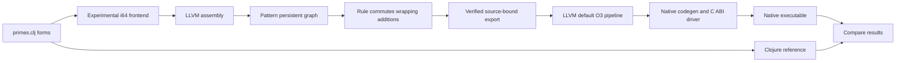

# Clojure forms to a native prime-counting program

This REPL experiment compiles the **same Clojure definitions** used for the JVM
reference into LLVM IR. The program counts primes and sums them through a supplied
limit, using helper calls, nested branches and loop-carried variables. The native
executable uses the system C runtime for argument parsing and printing; it starts
without a JVM.



From the Pattern root, after building the optional bridge:

```sh
LLVM_CONFIG=llvm-config-21 CXX=clang++-21 python3 modules/llvm/native/build.py
LLVM_CONFIG=llvm-config-21 clojure -J-Xmx384m -M:llvm
```

In that REPL:

```clojure
(load-file "modules/llvm/examples/run.clj")
(def result
  (pattern.llvm.examples.run/run! "modules/llvm/target/native-primes/example-1"))
(clojure.pprint/pprint result)
```

Use a **new output directory** for every run. The experiment leaves the original,
rewritten and optimized `.ll` files, two native executables, semantic-probe source
and executable, and `observation.edn`. With that example directory:

```sh
modules/llvm/target/native-primes/example-1/primes 100000
# 9592 454396537
```

Both native versions, before and after Pattern rewriting/LLVM optimization, match
the Clojure reference on ten limits from -10 through 100,000. Eight additional
compiler probes check parallel `recur`, nested loops, binding scope, signed
division/remainder, wrapping overflow, bit operations and comparisons. Seven source
forms outside the subset are explicitly rejected. The checked-in
[observation](native-primes-observation.edn) records the local run; these checks
are separate from the module's normal test runner. The opt-in LLVM acceptance CI
also runs this complete example, including native builds and differential checks.

## Supported source and semantics

[i64.clj](i64.clj) is a small frontend operating on data. `compile-module` accepts a
vector of simple, single-arity, single-body `defn` forms and returns LLVM assembly
without evaluating them. The example runner separately loads the trusted
repository-owned Clojure program and evaluates fixed semantic probes as references.
The frontend is a handwritten emitter, rather than a Pattern nanopass pipeline;
Pattern performs the persistent LLVM graph rewrite afterward. See the
[compiler-author guide](../COMPILERS.md) for the intended dialect/pass architecture.

- All function arguments, function results and loop variables are signed 64-bit
  integers. Integer literals must be Clojure `Long` values; explicit BigInt (`N`)
  literals are rejected even when their current value fits in 64 bits. Comparisons
  produce LLVM `i1` values used as `if` conditions. This is
  an imposed representation, rather than a general inference pass.
- Supported forms: integer literals, locals, calls to functions in the compilation
  unit, `if`, single-body `let`, and single-body `loop/recur` with nonempty integer bindings. Loop initializers and
  `let` bindings are sequential; `recur` arguments update loop variables in
  parallel and must appear in tail position. Loops lower to PHIs and backedges.
- Supported primitives: two-argument `unchecked-add`, `unchecked-subtract`,
  `unchecked-multiply`, `bit-and`, `bit-or`, `bit-xor`, `quot`, `rem`, and comparisons
  `<`, `<=`, `>`, `>=`, `=`, `not=`, plus `unchecked-inc`.
- Arithmetic uses wrapping `i64` operations without LLVM overflow promises.
  Division/remainder check zero and the signed MIN/-1 pair and trap in native
  code. General Clojure exception behavior and promotion are outside the subset.
- The driver accepts limits from -1,000,000 through 1,000,000. The recorded run
  covers the smaller range above. Other callers of the exported C ABI must respect
  argument representations and their own termination/workload constraints.

There is no general macro expansion, dynamic Var dispatch, arbitrary precision,
object/collection lowering, allocation runtime or automatic JVM interop here.
Unknown operations fail instead of falling back to host evaluation. This is a
prototype for compiling closed numeric regions, not a complete Clojure implementation.

The Pattern pass performs ten recorded operand edits across five wrapping
additions. It deliberately demonstrates persistent map rewriting and preservation,
rather than claiming to improve performance. LLVM's optimizer handles native
optimization afterward. The exporter establishes LLVM validity; the chosen
commutative rewrite and differential checks supply separate semantic evidence.
No JVM-versus-native speed comparison is claimed.
